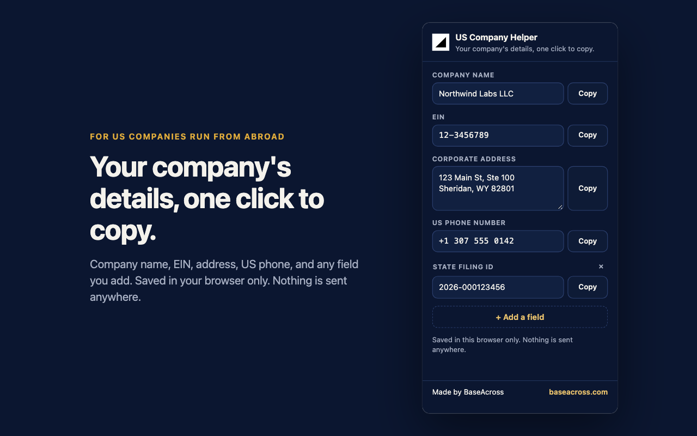

# US Company Helper

A Chrome extension for founders running a US company from abroad. It keeps your company name, EIN, corporate address, US phone number and up to 20 fields of your own in your browser, and copies each one with a click.

**Website:** https://medvizo-inc.github.io/us-company-helper/

## Install

The Chrome Web Store listing is in review. Until it is live:

1. Download this repository (**Code → Download ZIP**) and unzip it.
2. Open `chrome://extensions` and turn on **Developer mode**.
3. Click **Load unpacked** and choose the `extension` folder.

## Privacy

Everything you type is saved in `chrome.storage.local` on your computer. The extension makes no network requests and asks for one permission, `storage`. See [the privacy page](https://medvizo-inc.github.io/us-company-helper/privacy.html).

## Files

- `extension/`: the extension itself (Manifest V3, plain HTML, CSS and JavaScript, no libraries)
- `docs/`: the website, served by GitHub Pages

## About

Made by [BaseAcross](https://baseacross.com), which forms and runs US LLCs and C-corps for founders outside the US. If you are still setting up, see [getting an EIN without an SSN](https://baseacross.com/ein).

## License

MIT. See [LICENSE](LICENSE).
